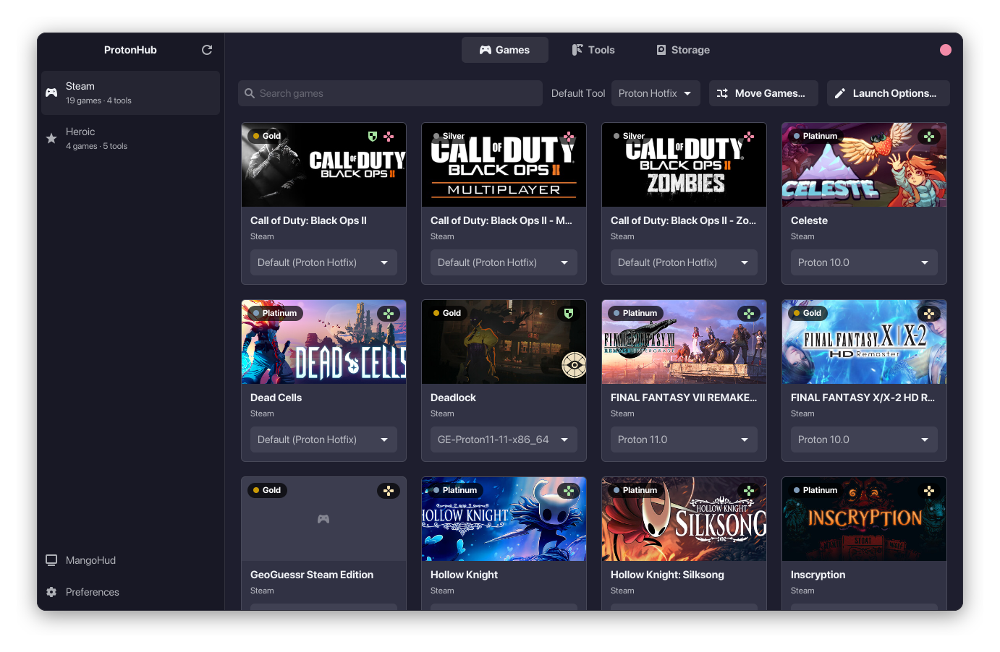
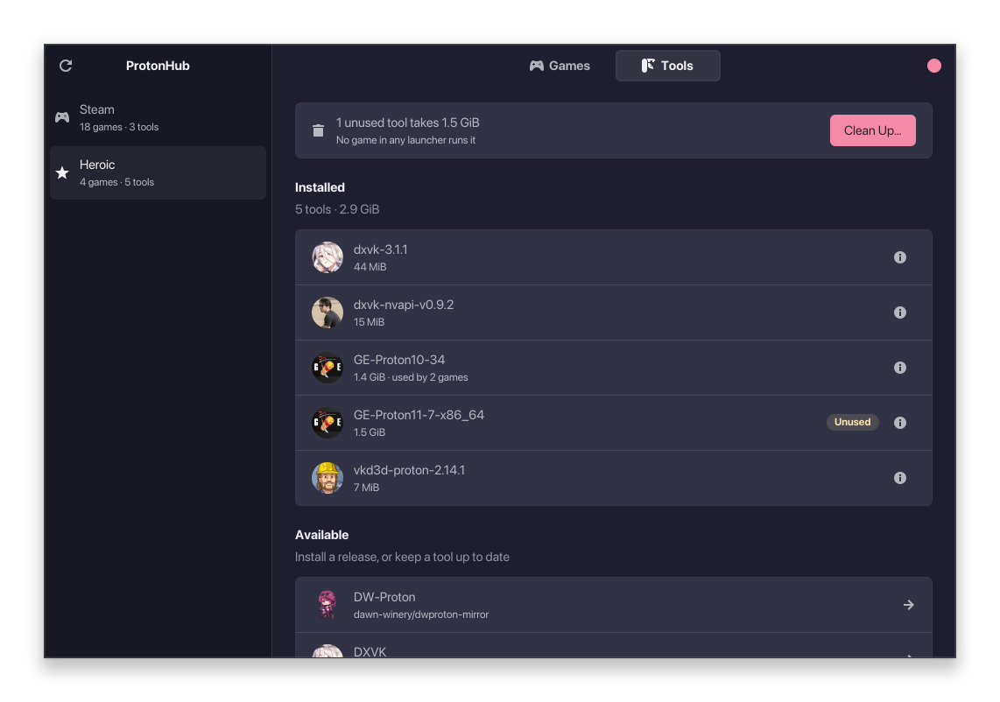
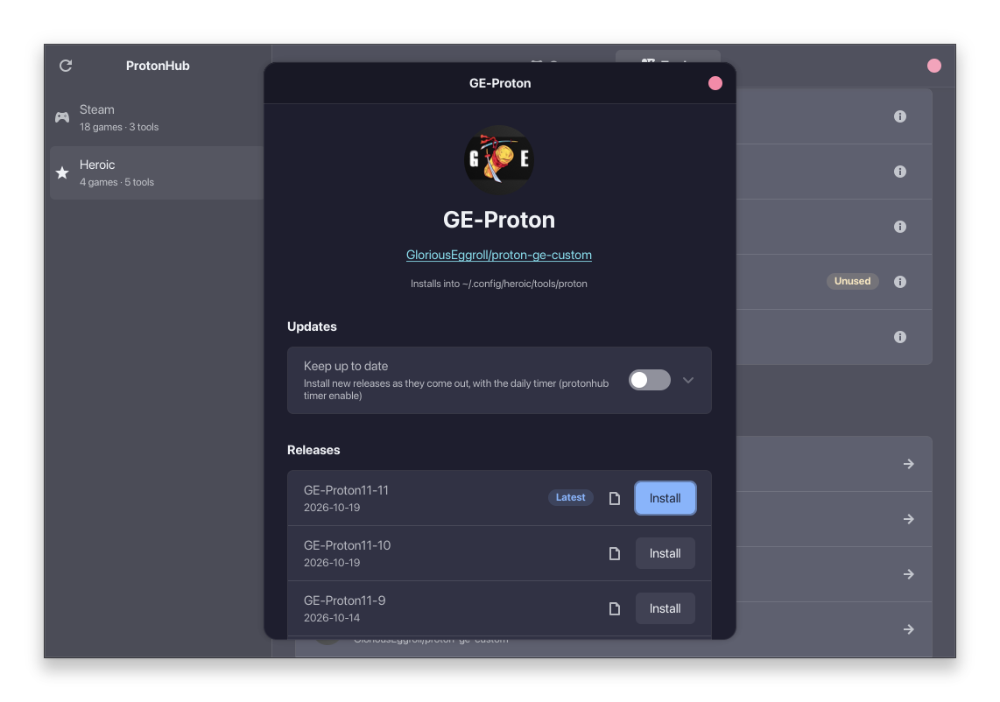
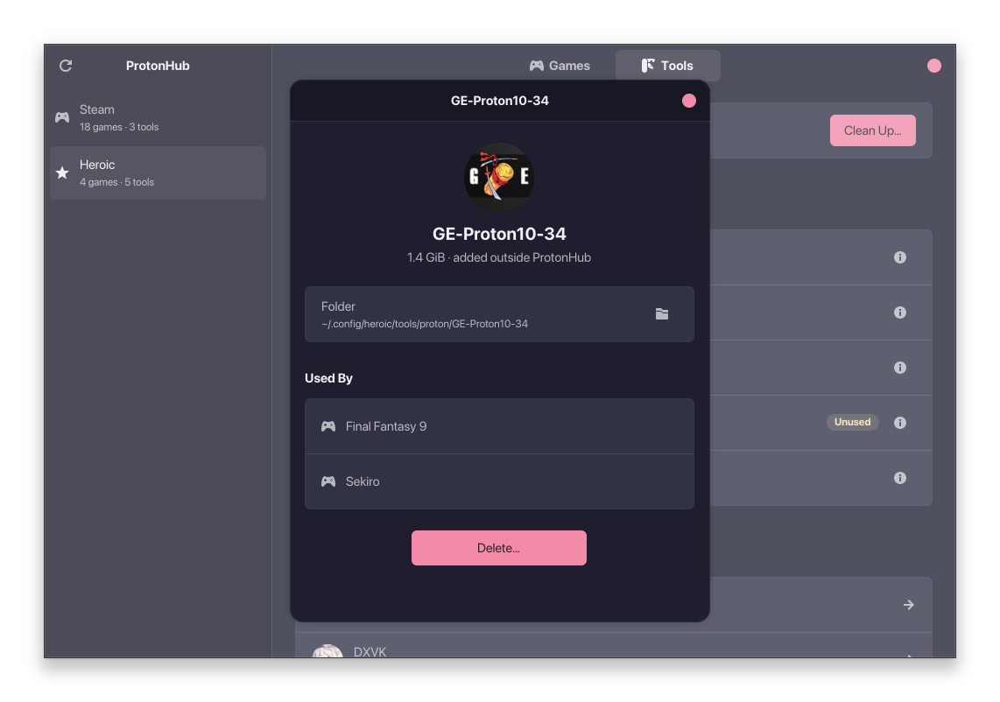

<div align="center">


# ProtonHub

**Install and manage Proton, Wine, DXVK and VKD3D builds across Steam,
Heroic, Lutris, Bottles, WineZGUI and Faugus Launcher.**

[](https://github.com/antoniosarro/protonhub/actions/workflows/ci.yml)
[](https://github.com/antoniosarro/protonhub/actions/workflows/registry.yml)
[](LICENSE)



</div>

ProtonHub is built around two rules:

- **Tools are data.** Each tool is a [TOML manifest](docs/manifests.md).
  When a project renames its release assets, the fix is a manifest change,
  and a nightly CI job resolves every tool's latest release to catch it.
- **No silent failures.** Every step returns a typed error saying what was
  expected and what was found. Nothing is picked "first match": an asset
  or checksum file must match exactly once.

It is a Rust library with two front ends: a GTK 4 + libadwaita app and a
scriptable CLI with JSON output.

## Features

- **22 tools**: GE-Proton, Proton-CachyOS, Wine-GE, Kron4ek's Wine and
  Wine-Staging, DXVK, DXVK-Sarek, DXVK-NVAPI, vkd3d-proton, Luxtorpeda,
  Boxtron and more
  ([the list](docs/manifests.md#the-tools)), from GitHub, Codeberg and
  GitLab. The list updates from this repository daily, so a fixed or new
  tool needs no release.
- **Every launcher**: Steam, Heroic, Lutris, Bottles, WineZGUI and Faugus
  Launcher, native, Flatpak or Snap.
- **Verified installs**: checksums matched to their asset by name,
  resumable downloads, atomic installs that never leave a half-extracted
  tool behind.
- **Per-game tools**: set the tool each Steam and Heroic game runs with,
  one at a time or in bulk, and Steam's default, with the previous
  settings file kept as a backup.
- **Launch options**: edit a Steam or Heroic game's launch options, with
  35 switches (MangoHud, GameMode, Native Wayland, HDR, FSR 4, DLSS
  and XeSS upgrades, WoW64, NVAPI, Anti-Lag and more) defined as data in
  [`presets.toml`](crates/core/presets.toml), each saying which Proton
  builds read it, and gamescope's resolution, frame rate and upscaling.
- **Prefix tools**: install winetricks components (Visual C++, .NET,
  DirectX, fonts…) into a Steam, Heroic or Faugus game's prefix with its own
  Proton, open winecfg or regedit there, or run a Windows program in it.
- **MangoHud editor**: its global settings, or a game's own, with a live
  preview of the real MangoHud over vkcube as you change them.
- **Usage map**: see which games in any launcher use each tool, and
  delete the ones nothing uses in one step.
- **Storage**: each Steam game's Wine prefix and shader cache by size,
  and the gigabytes uninstalled games left behind, deleted in one step.
- **Release channels**: keep a tool at its latest release, keep the newest
  N versions, move games onto new releases, all from a daily systemd user
  timer with desktop notifications. No daemon.
- **Game info**: ProtonDB ratings, Are We Anti-Cheat Yet statuses and
  Valve's Steam Deck ratings.
- **Lockfiles**: export what is installed on one machine and apply it on
  another.
- **Gamepad and Steam Deck**: the D-pad drives the window, which starts
  fullscreen in Game Mode; one button adds ProtonHub to Steam's library
  to open it there.
- **Error log**: every failure with its full message and a button that
  copies it with the version and platform for a bug report.

<table>
  <tr>
    <td></td>
    <td></td>
    <td></td>
  </tr>
  <tr align="center">
    <td>Installed and available tools</td>
    <td>Releases and auto-update</td>
    <td>What uses a tool</td>
  </tr>
</table>

## Install

Each [release](https://github.com/antoniosarro/protonhub/releases) has an
Arch package, a `.deb` (Debian 13+, Ubuntu 24.10+), an `.rpm` (Fedora) and a
Flatpak bundle, for x86_64. To build one yourself:

| | |
|---|---|
| **Arch Linux** | `makepkg -si` in [`packaging/arch`](packaging/arch/PKGBUILD) (`protonhub-git`) |
| **Fedora** | `packaging/build.sh rpm` ([spec](packaging/rpm/protonhub.spec)) |
| **Debian, Ubuntu** | `packaging/build.sh deb` ([`debian/`](packaging/debian)) |
| **NixOS, Nix** | the flake's package, overlay, NixOS and home-manager modules |
| **Flatpak** | `just pkg flatpak` ([manifest](packaging/flatpak/dev.antoniosarro.ProtonHub.yml)) |
| **From source** | `just pkg install` (to `~/.local`) |

Each is described, with its requirements, in
[packaging/README.md](packaging/README.md). With Nix:

```sh
nix run github:antoniosarro/protonhub -- --help              # the CLI
nix shell github:antoniosarro/protonhub -c protonhub-gtk     # the GUI
```

## Use

Open **ProtonHub** from your app menu, or run `protonhub-gtk`. The same
things from a terminal:

```sh
protonhub launchers                                            # the launchers found
protonhub install ge-proton --launcher steam                   # latest release, verified
protonhub games                                                # each game and its tool
protonhub assign "Elden Ring" GE-Proton11-7 --launcher steam   # change one
protonhub cleanup --yes                                        # delete tools nothing uses
protonhub channel add ge-proton --launcher steam --move-games  # keep it updated
protonhub timer enable                                         # daily, with notifications
```

Every command takes `--json`. See [docs/usage.md](docs/usage.md) for all
of them and [docs/gui.md](docs/gui.md) for the app.

## Documentation

- [Using the GUI](docs/gui.md) and [the CLI](docs/usage.md)
- [Tool manifests](docs/manifests.md): the format, and adding a tool
- [Architecture](docs/architecture.md): the crates and the installer pipeline
- [Translating](docs/translating.md)
- [Packaging](packaging/README.md)

## Development

The [flake](flake.nix) has the toolchain and every library (`nix develop`,
or `direnv allow`); elsewhere you need Rust 1.92+, GTK 4.12+,
libadwaita 1.6+, libudev and gettext. [`just`](justfile) lists the recipes:

| Recipe | |
|---|---|
| `just run ARGS` | build and run the CLI |
| `just gui` | build and run the GUI, with translations |
| `just test` | core tests (plain `cargo test` skips the GUI crate) |
| `just check` | fmt, clippy, tests and the registry check, before a commit |
| `just gui-check` | clippy and tests for the GUI crate |
| `just registry-verify` | resolve every tool's latest release over the network |

## Limitations

- Per-game tools are set for Steam, Heroic and Faugus Launcher only;
  Lutris, Bottles and WineZGUI get installs and removals. Launch options
  are for Steam and Heroic games, prefix tools for Faugus's too.
- Tools only released as CI artifacts (Proton-Tkg, Wine-Tkg, DXVK
  nightly) and SteamTinkerLaunch are not covered.
- Inside the Flatpak, ProtonHub can't see whether Steam or Heroic is
  running, can't install the systemd timer, can't preview MangoHud, and
  can't run winetricks.
- On NixOS, prefix tools need `steam-run`: Proton's Wine is a 32-bit
  program for a usual Linux system.
- Flatpak Steam's MangoHud reads its global settings from Steam's own
  sandbox, not `~/.config/MangoHud`; a game's own settings work there too.

## License

[MIT](LICENSE).
