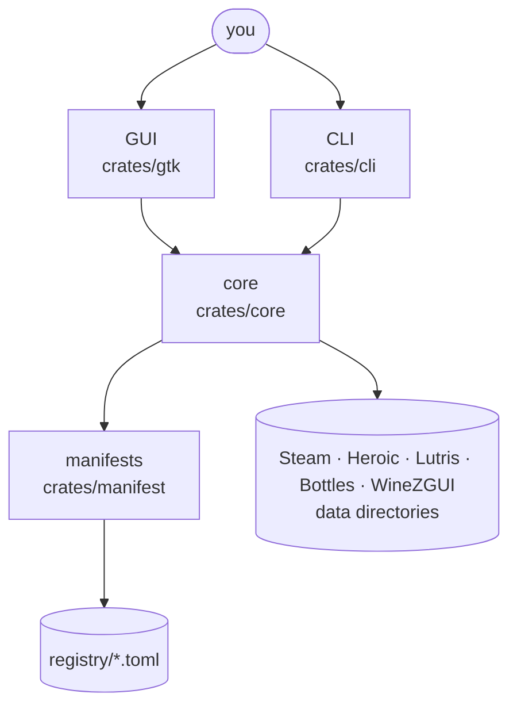

# Architecture

protonhub is a Rust workspace. The logic lives in libraries; the CLI and the
GUI are thin layers over them, so everything the GUI can do is scriptable.

## Crates

| Crate | Role |
| --- | --- |
| `crates/manifest` (`protonhub-manifest`) | The manifest schema, loading `registry/`, and resolving a release to the one asset and checksum for an arch ([manifests.md](manifests.md)) |
| `crates/core` (`protonhub-core`) | `launcher`: detection (native, Flatpak, Snap). `releases`: GitHub, Forgejo and GitLab releases and fixed URLs, ETag cache, resumable downloads. `install`: the installer pipeline, listing, removal. `games`: games, per-game tools and usage across launchers, with `steam` and `heroic` behind it. `storage`: Steam's prefixes and shader caches, and the ones uninstalled games left. `channels`: keeping tools at their latest release. `lock`: lockfiles. `info`: ProtonDB ratings and Are We Anti-Cheat Yet statuses. `vdf`: Valve's text and binary KeyValues. `paths`: XDG directories. Re-exports `manifest` |
| `crates/cli` (`protonhub-cli`, binary `protonhub`) | The command line ([usage.md](usage.md)), and the systemd user timer (`timer.rs`) |
| `crates/gtk` (`protonhub-gtk`, binary `protonhub-gtk`) | The GTK 4 + libadwaita GUI ([gui.md](gui.md)). `window`: the sidebar, the snapshot read on a worker thread, and jobs. `page`: a launcher's page, a module of a file per tab (`games` with `game_row`, `tools`, `storage`). `tool`, `details`: a tool's releases, an installed tool's users. `errors`: the error log. `art`: pictures, decoded off the main thread and cached. `gamepad`: gilrs, polled on the main loop. `i18n`: gettext ([translating.md](translating.md)) |

`crates/gtk` is a workspace member but not a default member: plain `cargo
build` and `cargo test` skip it, so the core's edit-test loop doesn't link
GTK. `just gui` and `just gui-check` build it, and so does the Nix package.

## Design choices

- **Tools are data.** See [manifests.md](manifests.md). Odd tools are
  covered by data too where possible: a fixed-URL source for a branch
  snapshot (Steam-Play-None), `dir` for archives without a top-level
  directory, `requires` for host programs. No tool in the registry needs
  code; SteamTinkerLaunch would, and isn't covered.
- **No silent failures.** Every fallible step returns a typed error
  (`thiserror`) that carries what was expected and what was found, such as
  the asset names of a release that matched nothing. The GUI shows errors
  rather than dropping them.
- **Exactly one, never the first.** When protonhub picks something from a
  list (an asset, a checksum file), anything other than exactly one match
  is an error. Taking the first match would pair GE-Proton11's x86_64
  tarball with its aarch64 checksum.
- **Testable without a machine.** Launcher detection takes the home
  directory as an argument, so tests build fixture homes; manifest tests
  use asset lists recorded from real releases
  (`crates/manifest/tests/registry.rs`).

## Games and launcher settings

`games::library` reads a launcher's installed games, the tool each runs
with (its own or the default), and the tools it could run with:

- **Steam**: games are the `appmanifest_*.acf` of every library in
  `libraryfolders.vdf` (Proton and the Steam runtimes left out), plus the
  non-Steam shortcuts in each user's binary `shortcuts.vdf`. Tools are
  `compatibilitytools.d` (named by the key in their
  `compatibilitytool.vdf`) and Valve's Proton builds in `steamapps/common`,
  whose internal names (`proton_9`, `proton_experimental`) are derived
  from the directory name. The mapping is `CompatToolMapping` in
  `config/config.vdf`, "0" being the default.
- **Heroic**: games are the installed entries of its library caches (Epic,
  GOG, Amazon, sideloaded), native Linux games left out. A game's tool is
  `wineVersion` in `GamesConfig/<game>.json`, else the default in
  `config.json`; a tool is identified by its binary.

`games::assign` refuses while the launcher's process runs, keeps the
previous file as `<name>.protonhub-backup`, and writes atomically. Steam's
`config.vdf` is rewritten by `vdf::to_string` in Steam's own layout: on a
real 66 KB `config.vdf` and every appmanifest, parsing and writing back is
byte-identical, so a change touches only its own entry. Heroic's JSON keeps
its key order (serde_json's `preserve_order`).

`games::usage` sizes every tool directory and finds its users across all
launchers: Heroic games can run Steam's tools, and Lutris game
configurations can name any tool by path (matched as text, which errs
toward keeping a tool). Only directories that games' settings point into
are judged; everything else is "can't tell" and never unused.

## Channels

`channels::update` installs a channel's latest release (with the release
already looked up, saving an API call), moves games from the tool's older
versions with `games::assign_many` (one `config.vdf` rewrite for all of
them), then prunes: the tool's versions are ranked newest first by the
source's own order, then by their tags compared as versions (numbers by
value: GE-Proton11-7 after GE-Proton10-34), then by install time, and
those past `keep` are deleted only if `games::usage` says nothing uses
them. No process stays running: `protonhub timer enable` installs a
systemd user timer that runs `protonhub update --notify` daily.

## The installer pipeline

`install::install` runs resolve → download → verify → extract → rename →
record, reporting each `Step` to a progress callback:

1. **Resolve.** Pick the release (`releases::Client::release`) and, through
   the manifest, its one asset and checksum file. Fail early if that
   version is already installed.
2. **Download** into `$XDG_CACHE_HOME/protonhub/downloads` as
   `<asset>.part`, resuming with a `Range` request when a partial file is
   there. A short download is `Incomplete` and is kept to resume. An
   asset of unknown size (GitLab's) is always downloaded whole.
3. **Verify** against the line naming the asset in the checksum file. A
   mismatch deletes the download and reports both digests.
4. **Extract** (`.tar.gz`, `.tar.xz`, `.tar.zst`) into a hidden staging
   directory inside the launcher's tool directory (same filesystem, so the
   rename is atomic). Progress counts
   the compressed bytes read. Entries reaching outside the staging
   directory, and archives without exactly one top-level directory, are
   errors.
5. **Record and rename.** `.protonhub.json` (tool, tag, asset, checksum,
   time) is written into the extracted directory, which is then renamed
   into place. A directory is either complete with its record or absent.
   An older version of the same tool in that directory is moved aside
   first and deleted.

The download and the staging directory are removed whatever the outcome,
except for an interrupted download. Removal renames the directory out of
the launcher's sight before deleting it.

### Release sources

API responses are cached under `$XDG_CACHE_HOME/protonhub/api` with their
ETags and revalidated, since a 304 doesn't count against GitHub's
unauthenticated limit of 60 requests an hour. `GITHUB_TOKEN` raises it to
5000, and is sent only to GitHub. A used-up limit is its own error, with
the reset time.

### Tests

`crates/core/src/testutil.rs` has a localhost HTTP server that answers
from a closure and logs requests, so the client and the whole pipeline are
tested without the network: ETag revalidation, the rate limit, resuming,
checksum mismatches, bad archive layouts and path traversal.
